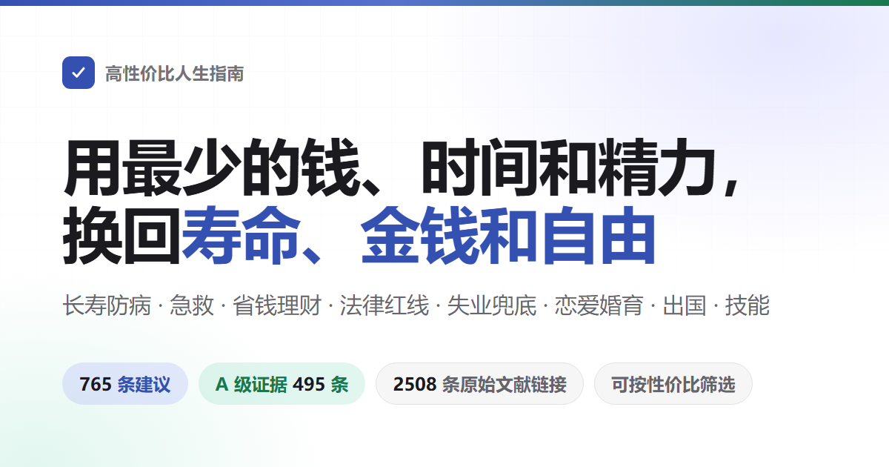

> **Bản dịch tiếng Việt chưa chính thức — bản nháp dịch máy.** [Thông tin bản dịch](TRANSLATION.md) · [Đối chiếu bản gốc tiếng Trung](../README.md).
> Luật, trợ cấp, số điện thoại và khoản tiền trong sách thuộc bối cảnh Trung Quốc đại lục; tiền tính bằng nhân dân tệ, trừ khi ghi rõ đơn vị khác.

<div align="center">



# Hướng dẫn cuộc sống có giá trị cao

Nói về cách sống lâu, cách ít ốm, khi có sự cố thì làm sao cứu. Nói về cách tiết kiệm tiền, những việc nào dễ bị lừa, dễ bị kiện. Nói về những gì có thể nhận được khi không có việc làm, mở cửa hàng, thành lập công ty, làm website cần làm thủ tục gì. Cũng nói về tình yêu, kết hôn, sinh con, đi nước ngoài và học tay nghề. Nội dung về luật pháp, bảo hiểm y tế, bảo hiểm xã hội được viết theo quy định hiện hành của Trung Quốc đại lục.<br>
[CHƯA DỊCH]

[CHƯA DỊCH]

[15. Thuê nhà và mua nhà](https://img.shields.io/badge/%E5%9C%A8%E7%BA%BF%E6%A3%80%E7%B4%A2-%E7%82%B9%E8%BF%99%E9%87%8C%E6%89%93%E5%BC%80-3451b2?style=flat-square)](https://eternity4719.github.io/HowToLiveBetter/)
[21. Du lịch và an toàn ở nước ngoài](https://img.shields.io/badge/%E6%9D%A1%E7%9B%AE-649%20%E6%9D%A1-18794e?style=flat-square)](#目录)
[27. Mang thai và sinh con](https://img.shields.io/badge/%E8%AF%81%E6%8D%AE%E5%88%86%E7%BA%A7-A%20428%20%C2%B7%20B%20171%20%C2%B7%20C%2050-915930?style=flat-square)](#证据分级)
[33. Học tập và làm việc ở nước ngoài: Hộ chiếu, làm thêm, bảo hiểm và xác nhận về nước](https://img.shields.io/badge/%E5%8E%9F%E5%A7%8B%E6%96%87%E7%8C%AE-1531%20%E6%9D%A1%E9%93%BE%E6%8E%A5-565a5f?style=flat-square)](../docs/核实记录/)
[16. Sống sau khi mắc bệnh mãn tính](https://img.shields.io/badge/%E8%AE%B8%E5%8F%AF-CC%20BY%204.0-565a5f?style=flat-square)](#许可)

### [Mở trang tra cứu trực tuyến](https://eternity4719.github.io/HowToLiveBetter/) · [Cho AI trả lời theo sách (skill)](../skills/life-decision-guide/README.md)

AI trợ lý skill hỗ trợ Claude Code và Codex. Cài đặt xong, chỉ cần hỏi

<table>
[CHƯA DỊCH]

[PDF](https://github.com/eternity4719/HowToLiveBetter/releases/download/epub-latest/HowToLiveBetter.pdf) · [EPUB](https://github.com/eternity4719/HowToLiveBetter/releases/download/epub-latest/HowToLiveBetter.epub) · [Tệp HTML đơn giản](https://github.com/eternity4719/HowToLiveBetter/releases/download/epub-latest/HowToLiveBetter.html)

</td></tr>
[CHƯA DỊCH]

[Mục lục](#目录) · [Bảng thuật ngữ](#读懂数字术语表) · [Ghi chép kiểm tra](../docs/核实记录/)

</td></tr>
[CHƯA DỊCH]

[CHƯA DỊCH]

</td></tr>
[CHƯA DỊCH]

[CHƯA DỊCH]

</td></tr>
[CHƯA DỊCH]

[CHƯA DỊCH]

</td></tr>
</table>

[CHƯA DỊCH]

</div>

---

## Câu hỏi

|Đi đâu xem|Những việc có thể làm mà không tốn tiền, giúp giảm nguy cơ chết sớm rõ rệt là gì?|
| --- | --- |
|[CHƯA DỊCH]|[CHƯA DỊCH]|
|[CHƯA DỊCH]|[CHƯA DỊCH]|
|Thời gian đã bỏ vào đâu, làm sao giảm việc không mang lại lợi ích, làm sao trị liệu sự trì hoãn?|[4. Đừng lãng phí thời gian](book/03.md|
|Tiền tiết kiệm nên để ở đâu, để không bị mất do lãi suất, phí và lừa đảo?|[5. Đừng lãng phí tiền](book/04.md|
|Những loại thực phẩm chức năng, gói kiểm tra sức khỏe, hàng hóa lừa đảo nào có thể không mua?|[6. Danh sách phản diện](book/05.md|
|Khi mất việc, bị nợ lương, không còn tiền, có thể nhận được gì, đi đâu xin giúp đỡ?|[7. Sống khi không có tiền](book/06.md|
|Lễ vật cưới, tài sản trước hôn nhân, chuyển tiền lớn trong thời gian hẹn hò thuộc về ai, khi bị tố cáo hoặc bị vu cáo thì bước đầu nên làm gì, tự mình thừa nhận sự việc có thể giảm hình phạt bao nhiêu, sau đó có thể truy cứu và yêu cầu bồi thường không?|[8. Pháp luật và an toàn tài sản](book/07.md|
|Cách truy tìm người, nên thả lưới rộng hay theo đuổi một người, tình yêu xa cách có thể thành công không, khi kết hôn cần mang theo gì?|[10. Tình yêu và kết hôn có đáng không](book/08.md|
|Viết mã nào, nhận đơn nào sẽ bị kết án?|[11. Những ranh giới pháp lý dễ vi phạm của lập trình viên và người kỹ thuật](book/09.md|
|Trước khi vay tiền để mở cửa hàng, thành lập công ty, điều quan trọng nhất nên suy nghĩ là gì?|[12. Khởi nghiệp và kinh doanh](book/10.md|
|Khi có người ngất xỉu, không thở, chảy máu nhiều, hỏa hoạn, lạc đường, nên làm gì trước tiên?|[13. Tình huống khẩn cấp: Nên làm gì trước tiên](book/11.md|
|Tài khoản bị đánh cắp, điện thoại bị mất, bước đầu nên làm gì?|[14. Tài khoản và an toàn thông tin](book/12.md|
|Khi bị chẩn đoán bệnh mãn tính, nên quản lý lâu dài như thế nào, làm sao tiết kiệm chi phí?|[16. Sống sau khi mắc bệnh mãn tính](book/13.md|
|Người già nên sắp xếp giám hộ, di chúc và tiền như thế nào?|[17. Gia đình có người già](book/14.md|
|Sinh con có thể nhận được gì, tốn bao nhiêu thời gian và tiền bạc?|[18. Có nên nuôi con không](book/15.md|
|Phụ cấp làm thêm, nghỉ phép năm nên tính thế nào, bị sa thải nên nhận bao nhiêu bồi thường, khi làm việc bị thương thì nhận tiền như thế nào?|[19. Làm việc, nghỉ việc và tai nạn lao động](book/16.md|
|Trẻ sơ sinh, việc quan trọng nhất là gì?|[20. Dạy con sơ sinh](book/17.md|
|Quốc gia nào hiện tại không nên đến, khi xảy ra sự việc, đại sứ quán có thể can thiệp đến mức nào?|[22. Giải trí và giảm căng thẳng](book/18.md|
|Đi đến quán karaoke, quán net, phòng bí mật, làm gì để không bị lừa, khi căng thẳng thì làm gì hiệu quả nhất?|[23. Học kỹ năng nào có lợi](book/19.md|
|Học hàn, học tiếng Anh, lấy chứng chỉ, những cái nào thực sự có lợi, học thế nào để tiết kiệm thời gian, chứng chỉ đăng ký ở đâu, có đáng không?|[24. Cách tiết kiệm chi phí và tránh sai lầm khi đi bệnh viện](book/20.md|
|Khi bệnh rất nặng, nên đăng ký khám hay đến quầy phân loại khẩn cấp, sau khi điều trị có nên làm giám định thương tật, xin giấy tờ người khuyết tật không?|[25. Sau khi người thân qua đời, cần làm gì](book/21.md|
|Khi người thân qua đời, bước đầu nên làm gì, những khoản tiền nào có thể rút lại, những khoản phí nào có thể không nộp?|[26. Làm một trang web hoặc nền tảng](book/22.md|
|Khi mang thai, sinh con, nên làm gì vào thời điểm nào, trước khi xuất viện cần làm những giấy tờ nào?|[28. Đừng làm hại cơ thể vì ngoại hình](book/23.md|
|Uống thuốc cảm, thuốc hạ sốt, thuốc dạ dày, những loại nào không nên dùng cùng nhau, trẻ em, phụ nữ mang thai và người già nên tránh những loại nào?|[29. Không nên gây hại cơ thể vì ngoại hình](book/24.md|
|Khi người thân qua đời, bị sa thải, nhận chẩn đoán bệnh nghiêm trọng, điều quan trọng nhất trong vài tháng đầu là gì?|[30. Sau khi gặp tổn thất lớn](book/25.md|
|Sau khi con đi học, những vấn đề về thể chất và tâm lý không nên để đến khi thi xong mới xử lý là gì?|[31. Trẻ em sau khi đi học](book/26.md|
|Sau 18 tuổi, ngoài học tập và làm việc còn có những con đường nào, rào cản của từng con đường là gì?|[32. Sau 18 tuổi có những con đường nào](book/27.md|
|Hộ chiếu, làm thêm, bảo hiểm và xác nhận về nước|[34. Cách sử dụng thuốc tại nhà không gây hại](book/28.md|
|Khi bản thân hoặc người thân bị khuyết tật, nên phòng ngừa những biến chứng nào trước tiên, có thể xin trợ cấp nào, học tập, làm việc và giám hộ như thế nào?|[35. Sống sau khi bị khuyết tật](book/29.md|
|Cách đọc|[CHƯA DỊCH]|
|[CHƯA DỊCH]|**Muốn chọn theo điều kiện**：Mở [trang tra cứu trực tuyến](book/31.md, nội dung chính sẽ được cập nhật theo trang.|
|**Các mục sẽ dẫn đến nhau** (dạng|[CHƯA DỊCH]|
|[CHƯA DỊCH]|**Muốn đọc trên Kindle hoặc thiết bị đọc sách khác**：Tải xuống [EPUB](book/33.md|
|**Ba định dạng này được tạo tự động mỗi lần cập nhật nội dung**，liên kết tải xuống không thay đổi; bản được chia sẻ sẽ không được cập nhật, hãy tham khảo phiên bản trực tuyến.|[CHƯA DỊCH]|

## **Chỉ muốn xem kết luận chắc chắn nhất**：Trên trang tra cứu, chọn cấp độ bằng chứng A, chỉ giữ lại 428 mục có số liệu cụ thể, đến từ phân tích tổng hợp hoặc thử nghiệm quy mô lớn.

- **Không cần làm hết**：Đây là danh sách lựa chọn được xếp theo giá trị, không phải danh sách nhiệm vụ. Chọn một hai điều là được, phần còn lại để đó, khi cần lại quay lại tra cứu.
- [CHƯA DỊCH]
- **Muốn chọn theo điều kiện**：Mở [trang tra cứu trực tuyến](https://eternity4719.github.io/HowToLiveBetter/)，可以按关键词、章节、证据等级来筛，也可以按「花不花钱、花多少时间、要不要毅力」这三样筛，几个条件能叠着用。页面上的内容直接取自, nội dung chính sẽ được cập nhật theo trang.
- **Các mục sẽ dẫn đến nhau** (dạng
- **Muốn đọc theo thứ tự**：Các mục trong mỗi chương được sắp xếp theo giá trị từ cao đến thấp, chỉ cần xem vài mục đầu tiên của mỗi chương là được.
- **Muốn xem offline hoặc gửi cho người khác**：Tải xuống [tệp HTML đơn giản](https://github.com/eternity4719/HowToLiveBetter/releases/download/epub-latest/HowToLiveBetter.html)，整本书连同检索和筛选都在这一个文件里，双击就开，不用服务器也不用联网，微信里也能直接传。
- **Muốn in hoặc xem trên điện thoại**：Tải xuống [PDF](https://github.com/eternity4719/HowToLiveBetter/releases/download/epub-latest/HowToLiveBetter.pdf)，A4 bố cục, hơn 200 trang, có mục lục, số trang và dấu trang, mỗi chương bắt đầu trang mới.
- **Muốn đọc trên Kindle hoặc thiết bị đọc sách khác**：Tải xuống [sách điện tử EPUB](https://github.com/eternity4719/HowToLiveBetter/releases/download/epub-latest/HowToLiveBetter.epub)，Kindle chỉ cần gửi qua Send to Kindle.
- **Ba định dạng này được tạo tự động mỗi lần cập nhật nội dung**，liên kết tải xuống không thay đổi; bản được chia sẻ sẽ không được cập nhật, hãy tham khảo phiên bản trực tuyến.
- **Không hiểu dãy số đó**：Mỗi mục đều có một dòng
- **Chỉ muốn xem kết luận chắc chắn nhất**：Trên trang tra cứu, chọn cấp độ bằng chứng A, chỉ giữ lại 428 mục có số liệu cụ thể, đến từ phân tích tổng hợp hoặc thử nghiệm quy mô lớn.
- **Chỉ muốn xem những việc đáng làm nhất** : Chọn "rất hiệu quả" để nhận được 111 mục không tốn tiền, không tốn thời gian, không cần ý chí, nhưng lại mang lại lợi ích lớn nhất. Sau đó kết hợp thêm "được gì lại", sẽ có danh sách ưu tiên theo tiêu chuẩn đó.
- **Không cần lo lắng khi thấy tiêu đề chương bắt đầu bằng "không"** : Tiêu đề chương nói về điều muốn tránh (không chết sớm, không lãng phí thời gian), chứ không phải mỗi mục đều nói bạn không được làm gì. Hành động thực tế được ghi rõ trong tiêu đề mục, luôn bắt đầu bằng động từ, tự nó đã nói rõ là "làm gì" hay "không làm gì". Trong cùng một chương có cả hai loại: chương 4 có "viết ra cụ thể thời gian, địa điểm, và điều gì sẽ xảy ra" và cũng có "không xem TV và tin tức liên tục". Đọc theo tiêu đề mục, không cần áp dụng ngữ khí của tiêu đề chương.

**Không cần lo lắng khi thấy tiêu đề chương bắt đầu bằng "không"** : Tiêu đề chương nói về điều muốn tránh (không chết sớm, không lãng phí thời gian), chứ không phải mỗi mục đều nói bạn không được làm gì. Hành động thực tế được ghi rõ trong tiêu đề mục, luôn bắt đầu bằng động từ, tự nó đã nói rõ là "làm gì" hay "không làm gì". Trong cùng một chương có cả hai loại: chương 4 có "viết ra cụ thể thời gian, địa điểm, và điều gì sẽ xảy ra" và cũng có "không xem TV và tin tức liên tục". Đọc theo tiêu đề mục, không cần áp dụng ngữ khí của tiêu đề chương.

```markdown
### 5. 把家里的食盐换成低钠盐（钾盐）
- 成本：一袋比普通盐贵几元。买的时候顺手换，不额外占时间。口味几乎不变。
- 说人话：得过中风或 60 岁以上有高血压的人，把家里的盐换成低钠盐，五年内死亡的概率低约 12%，中风低约 14%。
- 收益：一项把人随机分成两组的试验，在中国农村做的，20995 人，都是得过卒中的人或者 60 岁以上的高血压病人，跟踪了 4.74 年。结果：用低钠盐的那组比用普通盐的那组，死亡风险低约 12%（RR 0.88）。卒中低约 14%（RR 0.86）。主要心血管事件低约 13%（RR 0.87）。
- Mức độ bằng chứng: A
- Nguồn: Neal B 等 (2021). Effect of Salt Substitution on Cardiovascular Events and Death. NEJM. https://doi.org/10.1056/NEJMoa2105675
- 备注：争议。试验对象是高危老人，健康年轻人换盐得到的好处要小得多。肾功能不全的人，或者正在吃保钾类药物的人，换盐前先问医生。
```

## **Chỉ muốn xem những việc đáng làm nhất** : Chọn "rất hiệu quả" để nhận được 111 mục không tốn tiền, không tốn thời gian, không cần ý chí, nhưng lại mang lại lợi ích lớn nhất. Sau đó kết hợp thêm "được gì lại", sẽ có danh sách ưu tiên theo tiêu chuẩn đó.

[CHƯA DỊCH]

**Chỉ muốn xem những việc đáng làm nhất** : Chọn "rất hiệu quả" để nhận được 111 mục không tốn tiền, không tốn thời gian, không cần ý chí, nhưng lại mang lại lợi ích lớn nhất. Sau đó kết hợp thêm "được gì lại", sẽ có danh sách ưu tiên theo tiêu chuẩn đó.

```bash
git clone https://github.com/eternity4719/HowToLiveBetter.git
cd HowToLiveBetter
python -m http.server 8000
```

[CHƯA DỊCH]

**Chỉ muốn xem những việc đáng làm nhất** : Chọn "rất hiệu quả" để nhận được 111 mục không tốn tiền, không tốn thời gian, không cần ý chí, nhưng lại mang lại lợi ích lớn nhất. Sau đó kết hợp thêm "được gì lại", sẽ có danh sách ưu tiên theo tiêu chuẩn đó.

```bash
cd tools/epub && npm ci && npm run build   # EPUB
node tools/offline/build.mjs               # 离线单文件 HTML
node tools/pdf/build.mjs                   # PDF，另需 pandoc ≥ 3.1 和 typst ≥ 0.13
```

[CHƯA DỊCH]

## Nguyên nhân ngược: quan hệ nhân quả bị đảo ngược: nhìn như việc trước gây ra việc sau, thực ra là việc sau gây ra việc trước. Không phải ngủ nhiều khiến chết sớm, mà là người bệnh ngủ nhiều

**Số tiền** : ít tốn tiền, dùng tiền đúng chỗ

- **Tự do cá nhân** : không vì không biết một đường đỏ mà bị giam giữ hoặc tạm giữ
- Mỗi lời khuyên có dạng như thế này:
- Tự chạy một bản
- [CHƯA DỊCH]

Nếu thực sự muốn chạy trên máy tính hoặc máy chủ của bạn:

[CHƯA DỊCH]

Nếu muốn tự tạo ba bản điện tử (thường không dùng, những gì trong Release là tự tạo):

[CHƯA DỊCH]

## Bốn loại tài nguyên

Sách này muốn giúp bạn giữ lại không chỉ tuổi thọ, mà còn bốn thứ khác:

|**Tuổi thọ** : sống lâu hơn, ít chết vì những điều có thể tránh được|**Thời gian và năng lượng** : thời gian sống không bị lãng phí vào việc không có lợi, mỗi ngày chú ý và sức lực ít bị tiêu hao vô ích|
| --- | --- |
| A |**Tiền bạc** : ít tốn tiền oan, dùng tiền đúng chỗ|
| B |**Tự do cá nhân** : không vì không biết một đường đỏ mà bị giam giữ hoặc tạm giữ|
| C |Mỗi lời khuyên đều trả lời hai câu hỏi: phải tốn gì (tiền/ thời gian/ năng lượng/ ý chí), có thể đổi lại được gì (thay đổi tỷ lệ tử vong tổng thể / giảm tử vong do nguyên nhân cụ thể / tiết kiệm thời gian và năng lượng / tiết kiệm tiền / đảm bảo và tự do cá nhân). Các mục được xếp theo hiệu quả, không theo loại: gần như không tốn chi phí, đổi lại lợi ích lớn nhất, được đặt ở đầu.|

**Lợi ích của một lời khuyên thuộc về ai, được phân theo cấp độ.** Theo mức độ lợi ích có thể trở lại với bạn: ① **Bản thân bạn**; ② **Vợ/chồng và người thân trực tiếp** (cha mẹ, con cái, ông bà, cụ nội, cháu nội, cháu ngoại); ③ **Bạn bè, đồng nghiệp và người thân khác** - mối quan hệ tương hỗ, những gì bạn giúp có thể được hoàn trả sau này; ④ **Người lạ** - cấp độ thấp nhất, nhưng không phải là không có: xác suất hoàn trả nhỏ, bạn không biết tính cách của họ, còn có nguy cơ bị lừa, bị phản bội, bị trả thù. Các cấp độ không được tính chung, khi đến cấp độ ④, lợi ích và rủi ro đều được ghi rõ.

Chương cấp cứu đọc theo cách này: 38.227 ca ngừng tim ngoài bệnh viện ở Trung Quốc, 79.2% xảy ra tại nhà, học ép tim trước tiên là để áp dụng cho người thân trong gia đình; các quy tắc như "nhìn thấy người bị đuối nước không xuống nước", "nhìn thấy ẩu đả đừng can thiệp" chính là quy tắc tự bảo vệ, phòng tránh bạn trở thành nạn nhân thứ hai. Việc có nên giúp người lạ hay không là quyết định của bạn, mục sẽ ghi rõ điều khoản miễn trách, hành động tự bảo vệ và mặt rủi ro, không thay bạn tính nó là lý do bắt buộc phải làm.

Số liệu về tỷ lệ tử vong, số liệu về thời gian và năng lượng, số liệu về tiền bạc và hậu quả pháp lý, mỗi thứ tính riêng, không chuyển đổi lẫn nhau. Bốn thứ này tương ứng với bốn mục "được gì" trên trang tra cứu, không so sánh với nhau.

## Phân cấp bằng chứng

Mỗi lời khuyên đều ghi rõ cấp độ bằng chứng:

|Cấp độ|Ý nghĩa|Có số liệu cụ thể, nguồn gốc là phân tích tổng hợp của nhiều nghiên cứu, nghiên cứu theo dõi nhiều người trong nhiều năm, hoặc thử nghiệm ngẫu nhiên có nhóm đối chứng (RCT), có thể nói rõ giảm bao nhiêu (HR, RR, tỷ lệ giảm)|
| --- | --- | --- |
|Có nghiên cứu hỗ trợ, nhưng không thể đưa ra số liệu cụ thể; hoặc chỉ có mẫu nhỏ, nghiên cứu đơn lẻ|Kinh nghiệm của tác giả, hoặc cách làm phổ biến, không có tài liệu nghiên cứu trực tiếp|Trong toàn bộ 649 mục, có 428 mục cấp A, 171 mục cấp B, 50 mục cấp C, thêm 65 mục ghi chú tranh cãi, 3 nơi ghi chú TODO cần kiểm tra. Các mục cấp A/B có tranh cãi sẽ ghi chú "tranh cãi" và liệt kê bằng chứng phản đối. Tất cả nguồn chỉ dẫn theo tài liệu gốc (bài báo khoa học kèm DOI hoặc liên kết PubMed, hoặc báo cáo của WHO/CDC/Ủy ban Thống kê Quốc gia), không dẫn theo tài liệu thứ hai. Số liệu không chắc chắn ghi "cần kiểm tra".|
|Cấp A chỉ nói "có số liệu cụ thể, nguồn gốc rõ ràng", không nói số liệu đó chắc chắn là nhân quả. Cấp A bao gồm cả thử nghiệm ngẫu nhiên có nhóm đối chứng, cũng có nghiên cứu chỉ theo dõi, không chia nhóm, loại sau không phân biệt được việc này có hiệu quả hay người làm việc này vốn khỏe hơn. Xem cột lợi ích: ghi "chia ngẫu nhiên thành hai nhóm" là loại trước, ghi "chỉ theo dõi, không chia nhóm" là loại sau. Đối với các mục pháp luật và chính sách, cấp A nghĩa là dẫn theo văn bản pháp luật hoặc tài liệu chính thức.|Tỷ lệ trong cột lợi ích và phần "nói theo cách dễ hiểu", phần lớn là giảm một phần so với người không làm, không phải mỗi 100 người giảm vài người. Cùng giảm 12%, số người già có nguy cơ cao giảm nhiều hơn người trẻ có nguy cơ thấp. Vì vậy trước tiên xem phần "nói theo cách dễ hiểu" nói về những người nào, sau đó xem tỷ lệ đó.|Phân cấp hiệu quả|
|Cấp độ bằng chứng chỉ trả lời "số liệu này có đáng tin không", không trả lời "việc này có đáng làm không". Vì vậy mỗi mục còn ghi thêm hai thứ: quy mô lợi ích (lợi ích lớn đến đâu) và tiêu chí (được gì). Trang tra cứu kết hợp hai thứ này cùng ba loại chi phí, tạo ra một cấp độ hiệu quả:|Độ|Giá trị|

Cách xác định

Tiêu chí

## Được gì (giảm tuổi thọ / giảm tiền / giảm thời gian và năng lượng / giảm tự do cá nhân)

Xem mục chính muốn được gì. **Không so sánh giữa các tiêu chí** , "giảm 12% tỷ lệ tử vong tổng thể" và "tiết kiệm 500 nhân dân tệ mỗi năm" không cùng một thước đo, không thể so sánh cao thấp

<details>
[CHƯA DỊCH]

|Lớn / Trung bình / Nhỏ|Dựa theo cột "lợi ích" của mục, theo giới hạn đã định trước, không theo cảm tính: giảm tuổi thọ xem giảm bao nhiêu phần trăm (≥20% là lớn, 10–20% là trung bình, <10% hoặc chỉ đo chỉ số trung gian mà không đo kết quả cuối cùng là nhỏ); giảm tiền xem số tiền (trên 10.000 nhân dân tệ là lớn, từ vài trăm đến vài nghìn là trung bình, vài chục nhân dân tệ là nhỏ); giảm tự do cá nhân xem hậu quả (tránh trách nhiệm hình sự là lớn, tránh giam giữ hoặc xử phạt hành chính là trung bình, tránh tranh chấp dân sự là nhỏ); giảm thời gian và năng lượng xem tiết kiệm bao nhiêu (tiết kiệm hàng giờ mỗi ngày là lớn, hàng giờ mỗi tuần là trung bình, chỉ tiết kiệm một lần là nhỏ)|
| --- | --- |
|Hiệu quả|Rất cao / Cao / Bình thường|
| HR |Lợi ích lớn, ba loại chi phí đều bằng không = rất cao; lợi ích lớn, chi phí không cao, hoặc lợi ích trung bình, chi phí bằng không = cao; còn lại = bình thường|
| RR |Trong toàn bộ 649 mục, có 111 mục hiệu quả rất cao (17%), 294 mục hiệu quả cao (45%), 244 mục hiệu quả bình thường (38%). Số mục ở giữa nhiều là có ý: quy mô lợi ích chỉ phân thành ba cấp độ lớn, trung bình, nhỏ, nếu chia nhỏ hơn sẽ là sự chính xác giả tạo.|
| OR |**Cấp độ này là đánh giá của tác giả, không phải bằng chứng**, theo tiêu chuẩn của cuốn sách này nó chỉ tính là cấp C; nó và cấp độ bằng chứng là hai thứ khác nhau, không ảnh hưởng lẫn nhau. Một mục có thể có bằng chứng cấp A nhưng hiệu quả chỉ tính bình thường (vắc-xin zona có 97.2% hiệu quả trong thử nghiệm RCT giai đoạn ba, nhưng hai mũi giá 3-4 nghìn nhân dân tệ, zona hiếm khi gây tử vong), cũng có thể bằng chứng chỉ cấp C nhưng hiệu quả rất cao (trước khi xuất cảnh, gửi hành trình cho gia đình). "Bình thường" không có nghĩa là không nên làm - tất cả các mục trong cuốn sách đều là lời khuyên nên làm, chỉ là cấp độ này bạn phải tự cân nhắc xem chi phí có đáng không.|
| IRR |Đọc hiểu số liệu (bảng thuật ngữ)|
| RaR |Nội dung chính cố gắng dùng cách nói hàng ngày, nhưng khi trích dẫn nghiên cứu thì không tránh khỏi một vài thuật ngữ thống kê. Nếu không hiểu thì tra bảng này; trên trang tra cứu trực tuyến, di chuột lên từ có đường nét đứt (trên điện thoại chạm vào) sẽ hiện giải thích.|
|[CHƯA DỊCH]|Thuật ngữ|
|Ý nghĩa|Tỷ lệ tử vong tổng thể|
| 95% CI |Tỷ lệ người chết trong một khoảng thời gian nhất định trong một nhóm người, bất kể nguyên nhân. Sách này dùng nó để đo "sống lâu đến mức nào". Trong nghiên cứu gốc gọi là tỷ lệ tử vong toàn bộ, viết tắt là ACM|
| RCT |Tỷ lệ rủi ro. Trong cùng một khoảng thời gian, tốc độ xảy ra sự việc (chết, mắc bệnh) của nhóm đã làm việc đó so với nhóm không làm. HR 0.87 có nghĩa là thấp hơn 13% so với nhóm không làm, HR 1.21 có nghĩa là cao hơn 21%|
|Tỷ lệ tương đối. Tỷ lệ xảy ra sự việc của hai nhóm, cách đọc số giống HR|Tỷ lệ chênh lệch. Cũng là so sánh hai nhóm, nhưng thuật toán khác một chút với RR: khi sự việc cần so sánh ít xảy ra, nó gần giống RR; khi sự việc xảy ra thường xuyên, nó sẽ phóng đại khoảng cách hơn thực tế|
|Tỷ lệ mắc bệnh. Tỷ lệ người mới mắc bệnh trong một khoảng thời gian nhất định, chia hai nhóm, cách đọc giống RR|Tỷ lệ số lần xảy ra. So sánh số lần sự việc xảy ra (ví dụ như ngã bao nhiêu lần), không phải số người bị ảnh hưởng, cách đọc giống RR|
|Tỷ lệ tử vong chuẩn hóa. Viết tắt là SMR. Số người chết thực tế của nhóm này chia cho số người chết dự kiến của người bình thường cùng độ tuổi. 5.86 có nghĩa là số người chết gấp 5.86 lần người cùng độ tuổi|Hiệu số rủi ro. Hiệu số của xác suất xảy ra sự việc giữa hai nhóm, trực tiếp cho biết "mỗi 1000 người có thêm bao nhiêu người". Số nhân chỉ nói gấp bao nhiêu lần, hiệu số rủi ro nói rõ số người thêm thực tế|
|Khoảng tin cậy 95%. Số liệu tính được luôn có sai số, đây là phạm vi mà giá trị thực có thể nằm trong. Đối với số liệu nhân, phạm vi vượt qua 1; đối với số liệu cộng trừ, phạm vi vượt qua 0, điều này cho thấy sự khác biệt giữa hai nhóm có thể chỉ là tình cờ, trong văn bản sẽ ghi "không có ý nghĩa thống kê"|Thử nghiệm ngẫu nhiên có đối chứng. Chia người thành hai nhóm bằng cách bốc thăm, một nhóm làm việc đó, một nhóm không làm, sau đó so sánh kết quả. Để chứng minh "chính việc này gây ra hiệu quả", phương pháp này có sức thuyết phục nhất|
|Phân tích tổng hợp|Tổng hợp kết quả của nhiều nghiên cứu để tính lại, đưa ra một con số tổng. Cũng gọi là phân tích meta|
| d、g |Nhóm nghiên cứu|
| r |Nghiên cứu nhóm. Chọn một nhóm người lớn theo dõi nhiều năm, ghi lại ai gặp sự việc. Có thể thấy hai việc thường xảy ra cùng nhau, nhưng không thể chứng minh việc trước gây ra việc sau|
| MET |Nghiên cứu quan sát|
| GRADE |Nghiên cứu quan sát. Người nghiên cứu chỉ ghi lại, không sắp xếp ai làm, ai không làm. Kết quả dễ bị ảnh hưởng bởi yếu tố khác (xem hai mục "tác động hỗn loạn", "nguyên nhân ngược"), số liệu nên xem có giảm bớt không|
|Tác động hỗn loạn|Một yếu tố thứ ba ảnh hưởng đồng thời đến nguyên nhân và kết quả, khiến hai việc nhìn như có mối quan hệ nhân quả. Ví dụ, người thích ăn rau thường cũng thích vận động, không thể phân biệt được cái nào gây ra hiệu quả|
|Nguyên nhân ngược|Đơn vị tính số điếu thuốc một người đã hút tổng cộng. Số điếu hút mỗi ngày nhân với số năm hút, 30 gói/năm nghĩa là hút một gói mỗi ngày trong 30 năm.|
| BMI |Chỉ số khối cơ thể, một con số thường dùng để xem cân nặng và chiều cao: số kilogram của cân nặng chia cho bình phương số mét của chiều cao.|
| LDL |Cholesterol lipoprotein mật độ thấp, còn được gọi là cholesterol xấu.|
| eGFR |Cholesterol lipoprotein mật độ thấp, còn được gọi là cholesterol xấu.|
| HBsAg |Chỉ số lọc cầu thận ước tính, một chỉ số đo khả năng lọc của thận, đơn vị là mL/min/1.73 m². Số càng thấp thì chức năng thận càng kém, phân giai đoạn bệnh thận mãn tính dựa trên chỉ số này.|
| HPV |Virus u nhú ở người. Nó có nhiều loại, một số loại nhiễm lâu dài có thể dẫn đến ung thư cổ tử cung.|
| LDCT |Chụp CT ngực liều thấp, lượng bức xạ khoảng 1/5 đến 1/10 của CT thông thường.|
| PM2.5 |Các hạt mịn trong không khí, đường kính dưới 2.5 micromet.|
| NOVA |Một phương pháp phân loại thực phẩm, chia thành bốn loại theo mức độ chế biến, 'thực phẩm chế biến nặng' là loại thứ tư.|
| LPR |Lãi suất tham chiếu thị trường cho vay. Tiêu chuẩn lãi suất vay trong nước, được công bố mỗi ngày 20 tháng, lãi suất thế chấp và lãi suất cho vay tư nhân đều được tính theo nó.|
|Phán quyết một lần là kết thúc.|Kết quả của trọng tài lao động có hiệu lực ngay lập tức, đơn vị không thể đưa vụ việc này ra tòa án để kiện tiếp.|
|Tỷ lệ kết hôn thô, tỷ lệ ly hôn thô.|Số cặp kết hôn và ly hôn được đăng ký trong năm tính theo mỗi 1.000 người. Ngoài ra còn có một con số gọi là tỷ lệ ly hôn trên kết hôn, là số cặp ly hôn trong năm chia cho số cặp kết hôn, không phải là cùng một thứ, đừng nhầm lẫn.|
| AED |Máy khử rung tim tự động. Hộp cứu trợ thường thấy ở nơi công cộng, màu đỏ hoặc vàng, khi bật máy theo hướng dẫn âm thanh thực hiện, việc có cần điện kích hay không do máy tự quyết định.|
| CPR |Cấp cứu tim phổi. Khi tim ngừng đập, ấn mạnh vào ngực để duy trì lưu thông máu.|
|Chứng nhận 3C.|Chứng nhận sản phẩm bắt buộc của Trung Quốc. Những sản phẩm nằm trong danh mục không được phép sản xuất hoặc bán nếu không có dấu hiệu này.|
|Bản ghi ICP.|Một thủ tục đăng ký trước khi website hoặc ứng dụng chính thức ra mắt, đăng ký vào hệ thống của Bộ Công nghiệp và Thông tin liên lạc.|
|Bảo vệ cấp bậc.|Hệ thống bảo vệ cấp bậc an ninh mạng. Phân loại theo mức độ quan trọng của một hệ thống thành các cấp bậc khác nhau, cấp bậc càng cao thì các biện pháp an toàn cần thực hiện càng nhiều.|
| GPL |Một giấy phép mã nguồn mở. Những thứ được tạo ra bằng cách sử dụng loại mã này thường phải công khai mã nguồn của chính mình khi phát tán ra ngoài.|
|Hạn chế cạnh tranh.|Một thỏa thuận với công ty: sau khi nghỉ việc, không được làm việc tại các công ty đối thủ trong một khoảng thời gian nhất định. Trong khoảng thời gian này, công ty phải trả tiền bồi thường cho bạn mỗi tháng, lâu nhất là 2 năm.|
|Vốn góp đã cam kết.|Số tiền mà bạn cam kết đầu tư khi đăng ký công ty. Sau khi cam kết, bạn phải thực sự đưa tiền ra trong thời hạn do luật định, không chỉ là một con số để trông có vẻ đẹp.|
|Tiền cọc và tiền đặt cọc.|Hai từ chỉ khác nhau một chữ, nhưng hiệu lực khác nhau rất nhiều: tiền cọc có quy định phạt, bên nhận tiền nếu vi phạm phải hoàn lại gấp đôi, số tiền tối đa là 20% giá trị hợp đồng; tiền đặt cọc chỉ là tiền trả trước, nếu vi phạm không có quy định phạt.|

</details>

## Mục lục

1. [Đừng chết sớm](book/01.md): nguyên nhân bên ngoài, khí ga và ngộ độc, vắc-xin, kiểm tra, thời gian của khủng hoảng tâm lý và ý nghĩ tự tử, điều gì xảy ra sau khi được cứu sống, năm sau khi bị ngã nặng, số tiền còn lại sau khi bán một quả thận, trang thiết bị khẩn cấp trong gia đình, các dấu hiệu cần kiểm tra như tiểu ra máu, dùng thuốc cho phụ nữ trên 65 tuổi bị loãng xương. Phương pháp đo: tỷ lệ tử vong tổng thể hoặc nguyên nhân tử vong cụ thể.
2. [Đừng chết từ từ](book/02.md): thuốc lá và rượu, vận động, giấc ngủ, chế độ ăn (muối ít natri, hạt óc chó, ngũ cốc nguyên hạt, thịt chế biến, dầu lạc tự ép, dầu thực vật thay thế dầu lợn), ngồi lâu, và các phương pháp cụ thể để bỏ thuốc lá và rượu (thuốc bỏ thuốc, ngày bỏ thuốc, phòng khám và đường dây nóng bỏ thuốc, thuốc lá điện tử, không tự chịu đựng cai rượu), thời lượng ngủ trưa, cách bù đắp sau khi thức khuya, số năm làm ca đêm, bật quạt hút mùi khi nấu ăn. Phương pháp đo: tỷ lệ tử vong tổng thể hoặc nguyên nhân tử vong cụ thể. Bài viết dài xem tại [docs/Chu kỳ sinh học và ca đêm.md](docs/dong-ho-sinh-hoc-va-ca-dem.md).
3. [Đừng lãng phí năng lượng](book/03.md): giấc ngủ, gián đoạn, đa nhiệm, nợ quan hệ, kỳ vọng khi giao tiếp với các tổ chức. Phương pháp đo: năng lượng/thời gian.
4. [Đừng lãng phí thời gian](book/04.md): các dự án không mang lại lợi ích, chi phí đã bỏ, trì hoãn (giải thích cảm xúc, thay đổi môi trường, thiết bị cam kết, thói quen cần bao lâu, tài liệu tự giúp đỡ), cuộc họp, đi làm. Phương pháp đo: thời gian.
5. [Đừng lãng phí tiền](book/05.md): đăng ký, xổ số, lãi suất, bảo hiểm, phí quỹ đầu tư, quỹ hưu trí cá nhân, bảo hiểm xe, tiền đặt cọc, mua sắm qua phát trực tiếp, tài khoản y tế cá nhân, trẻ em bị lừa và hoàn tiền, vòng tay, đồng hồ, đồ chơi không được tính như đầu tư, cách kiểm tra giấy chứng nhận của trang sức và đá quý, hộp bài, cách mua tài sản nước ngoài hợp pháp, cuối chương nói về bảo hiểm: chỉ mua cho những tổn thất không thể chịu đựng được, người kiếm tiền nên mua bảo hiểm nhân thọ định kỳ trước, hoàn tiền trong thời gian chờ đợi, đừng xem bảo hiểm như tiền gửi ngân hàng, đừng tìm đại lý hoàn tiền, người được hưởng và thời gian giải quyết bồi thường. Phương pháp đo: tiền bạc.
6. [Danh sách tiêu cực](book/06.md): những thứ có vẻ giá trị nhưng thực ra không cao, bao gồm
7. [Sống sót khi không có tiền](book/07.md): trợ giúp, trợ cấp, tìm việc, chỗ ở và ăn uống, y tế, tranh chấp tiền lương, tránh bị lừa. Phương pháp đo: tiền bạc/bảo đảm.
8. [Đừng tự đưa mình vào rắc rối: an toàn pháp lý và tài sản](book/08.md): tai nạn giao thông, bị lừa và dừng thanh toán, thay đổi khuôn mặt và giọng nói bằng AI, tự đầu thú và khai báo trung thực có thể giảm hình phạt bao nhiêu và tại sao
9. [Những đường đỏ mà người bình thường dễ vi phạm](book/09.md): tin đồn, sỉ nhục anh hùng cách mạng, chỉ xem nội dung nước ngoài chứ không chia sẻ, phát tán nội dung khiêu dâm, làm việc rửa tiền bán hàng, làm giả tài liệu để vay tiền, làm giả tai nạn để nhận bồi thường, ném đồ từ trên cao, súng mô phỏng, máy bay không người lái, quay lén, giới hạn giữa việc nuôi con hợp pháp và buôn bán, bắt cóc, đánh bạc, thực phẩm hoang dã, bán cơ quan và tìm người hiến tặng. Phương pháp đo: tự do cá nhân/tiền bạc.
10. [Liệu có đáng để yêu và kết hôn](book/10.md): chiến lược chọn bạn đời, ranh giới của sự theo đuổi, tín hiệu sở thích, chất lượng mối quan hệ, tình yêu xa cách, quy trình đăng ký, kiểm tra sức khỏe, chi phí sức khỏe, thời gian, tiền bạc, tài sản của cha mẹ mua nhà và nợ chung của vợ chồng, chi phí rời bỏ, cách cùng nhau làm trị liệu khi mối quan hệ bị kẹt. Bài viết dài xem tại [docs/Kết hôn có đáng không.md](docs/ket-hon-co-dang-khong.md).
11. [Những đường đỏ mà lập trình viên và người kỹ thuật dễ vi phạm](book/11.md): phần mềm gian lận, robot thu thập dữ liệu, phần mềm mua vé, xóa cơ sở dữ liệu, mang theo mã nguồn, nhận đơn phát triển, cạnh tranh, giấy phép mã nguồn mở, đăng ký.
12. [Khởi nghiệp và kinh doanh: đừng để mất hết tài sản](book/12.md): vốn, bảo lãnh, lựa chọn chủ thể, đăng ký, giấy phép, khai báo thuế, hóa đơn, lừa đảo thuế, hợp đồng, tuyển dụng, sản xuất hàng loạt, quyền sở hữu trí tuệ trong mua hàng và sử dụng hình ảnh, rời khỏi thị trường. Phương pháp đo: tiền bạc/trách nhiệm pháp lý.
13. [Tình huống khẩn cấp: nên làm gì trước tiên](book/13.md): ngừng tim, đột quỵ và đột quỵ ở vòng tuần hoàn sau, đột quỵ mắt, nhồi máu cơ tim, phình động mạch chủ, đau đầu dữ dội, tụ máu màng cứng mãn tính, thuyên tắc phổi, chảy máu nặng, vết cắn, bỏng, sốc dị ứng, động kinh, hạ đường huyết, điện giật, carbon monoxide, nuốt nhầm và bỏng do hóa chất, vật thể lạ đâm vào cơ thể, gãy xương, lừa đảo, đe dọa riêng tư, say nắng, hỏa hoạn, đuối nước, lạc đường, hạ thân nhiệt, rắn cắn, động đất, thú hoang, sét đánh, bệnh cao nguyên, bọ chét, nước uống ngoài trời; và khả năng chi trả: cách đỡ người già ngã, xử lý khi thấy ẩu đả, ai sẽ chịu chi phí khi bị thương khi cứu người; cuối chương là trẻ sơ sinh bị nghẹn và hồi sức tim phổi cho trẻ sơ sinh. Phương pháp đo: tỷ lệ sống sót và tiền bạc, vài mục cuối liên quan đến tự do cá nhân.
14. [Tài khoản và an toàn thông tin](book/14.md): xác minh hai yếu tố, mật khẩu, SIM, điện thoại bị mất, thẻ ngân hàng bị trộm, thiết bị đăng nhập, quyền của ứng dụng, nhận diện khuôn mặt, quyền xem và xóa. Phương pháp đo: tiền bạc/thông tin cá nhân.
15. [Thuê nhà và mua nhà](book/15.md): tiền cọc, trục xuất bạo lực, trung gian thu tiền, giám sát tiền, nguyên tắc
16. [Sau khi mắc bệnh mãn tính thì sống thế nào](book/16.md): tuân thủ thuốc, thanh toán y tế đặc biệt cho bệnh mãn tính ở các tỉnh, hồ sơ kiểm tra lại, đừng ngừng thuốc thử phương pháp dân gian, đơn thuốc dài hạn, ký hợp đồng với bác sĩ gia đình, kiểm tra biến chứng, phòng ngừa tái phát sỏi thận, điều trị đạt chuẩn cho bệnh gout. Phương pháp đo: tỷ lệ tử vong tổng thể/tiền bạc. Bài viết dài xem tại [docs/Sau khi được chẩn đoán bệnh mãn tính.md](docs/sau-chan-doan-benh-man-tinh.md).
17. [Có người già trong nhà](book/17.md): giám hộ theo ý chí, hình thức di chúc, tài khoản và cách nói chuyện, lừa đảo đầu tư hưu trí và hưu trí bằng nhà đất, bảo hiểm chăm sóc dài hạn, phòng ngừa loét do nằm lâu, nếu đục thủy tinh thể ảnh hưởng đến việc nhìn đường thì nên đánh giá phẫu thuật. Phương pháp đo: tiền bạc/tự do cá nhân, hai mục về loét và đục thủy tinh thể là tỷ lệ tử vong.
18. [Việc nuôi con có đáng không](book/18.md): trợ cấp nuôi con, nghỉ sinh sản và trợ cấp sinh sản, bảo vệ trong ba giai đoạn, thời gian, tiền bạc.
19. [CHƯA DỊCH]
20. [Trẻ sơ sinh nên được chăm sóc thế nào](book/20.md): ngủ an toàn, tiêm vắc-xin viêm gan B lần đầu, tiêm chủng theo chương trình, sữa mẹ và thực phẩm bổ sung, nhiệt độ nước pha sữa, mật ong, vitamin K, các dấu hiệu cần đến bệnh viện khi sốt, không lắc trẻ, tã và mua sắm đồ lớn, đưa đậu phộng sớm cho trẻ có nguy cơ dị ứng, các dấu hiệu cần đến bệnh viện khi trẻ sơ sinh bị vàng da.
21. [Đi nước ngoài, du lịch và an toàn ở nước ngoài](book/21.md): mức độ nhắc nhở an toàn, 12308, giới hạn của bảo hộ lãnh sự, bảo hiểm y tế ở nước ngoài, lừa đảo tuyển dụng lương cao ở nước ngoài, hạn mức rút tiền mặt ở nước ngoài, mất giấy tờ, bằng lái xe ở nước ngoài, đăng ký trung gian.
22. [Làm thế nào để thư giãn: địa điểm giải trí và giảm căng thẳng](book/22.md): lối thoát hiểm, giá niêm yết, đường đỏ liên quan đến ma túy, đồ vật do người khác đưa, lựa chọn địa điểm cho trò chơi kịch bản; thể thao, chánh niệm, thở, giao tiếp xã hội, không gian xanh. Phương pháp đo: tiền bạc/tự do cá nhân, cũng như năng lượng/tỷ lệ tử vong tổng thể.
23. [Học kỹ năng nào có lợi](book/23.md): học hay làm việc (độ tuổi lao động trẻ, giáo dục và tỷ lệ tử vong, cấu trúc học vấn toàn quốc, miễn học phí và học bổng, vay học phí, con đường nâng cao trình độ trung học, cách tự tính toán chi phí này), tỷ suất hoàn vốn giáo dục, chứng chỉ giả, trợ cấp đào tạo, kỹ năng nào khó bị máy móc thay thế, cấp bậc kỹ năng, cách tra cứu nghề khan hiếm, và sau khi quyết định học kỹ năng nào thì học thế nào (tự kiểm tra, luyện tập phân tán, không chỉ tập trung vào trọng tâm, luyện tập xen kẽ, không có bằng chứng về phong cách học tập), cuối cùng là chứng chỉ chuyên môn (kênh đăng ký, đánh giá thay thế, hậu quả của gian lận đánh giá, được đánh giá không đồng nghĩa với được thuê). Phương pháp đo: tiền bạc/thời gian, một mục liên quan đến tỷ lệ tử vong.
24. [Đi bệnh viện: làm thế nào để tiết kiệm tiền và không đi sai đường](book/24.md): phân cấp điều trị và chuyển tuyến, tính liên tục của điểm khởi đầu, tỷ lệ bồi thường khác nhau, nguồn đặt lịch hẹn, đánh giá cần thiết của việc đi bệnh viện ở nước ngoài, lưu giữ và niêm phong hồ sơ bệnh án, thứ tự phân loại khẩn cấp của phòng cấp cứu, cứu trợ bệnh lý khi không đủ khả năng chi trả, thời điểm định mức thương tật, làm thế nào để xin giấy chứng nhận người khuyết tật, không cần đưa tiền hối lộ cho bác sĩ.
25. [Sau khi người nào đó qua đời thì cần làm gì](book/25.md): báo cảnh sát và giấy chứng tử, vận chuyển và hỏa táng thi thể, khiếu nại nguyên nhân tử vong và giám định pháp y, xóa đăng ký hộ khẩu, danh sách các dự án tang lễ cơ bản, vi phạm giá, đăng ký trung gian, số dư quỹ hưu trí và chế độ bảo hiểm xã hội, quyền thông tin cá nhân của người đã khuất. Phương pháp đo: tiền bạc.
26. [Xây dựng một trang web hoặc nền tảng: Chứng chỉ, đăng ký và máy chủ](book/26.md): Đường đỏ thanh toán, giấy phép ICP và đăng ký, chứng chỉ phát trực tiếp và truyền hình, xác minh nền tảng và báo cáo thuế, quản lý nội dung, xác thực danh tính, trẻ em vị thành niên, thông báo xóa, xuất dữ liệu, lựa chọn máy chủ. Cách tiếp cận: Tự do cá nhân/ tiền bạc. Bài viết dài xem tại [docs/ làm nền tảng cần có những giấy tờ gì.md](docs/giay-phep-cho-nen-tang.md).
27. [Mang thai và sinh nở: Từ khi phát hiện mang thai đến khi xuất viện và làm giấy tờ](book/27.md): Axit folic, lập hồ sơ và khám thai miễn phí, xét nghiệm ba bệnh và ngăn chặn lây truyền từ mẹ sang con, rượu và thuốc lá trong thai kỳ, aspirin và tiểu đường thai kỳ, dấu hiệu cần đến bệnh viện ngay, xử lý nước ối vỡ, sinh không đau, chỉ định mổ lấy thai, bảo hiểm sinh sản, giấy chứng sinh, xét nghiệm sơ sinh, đăng ký và đăng ký thường trú, kiểm tra sau sinh 42 ngày. Cách tiếp cận: Tỷ lệ tử vong và tiền bạc. Bài viết dài xem tại [docs/ những việc cần làm trước và sau khi sinh con.md](docs/viec-can-lam-truoc-va-sau-khi-sinh-con.md).
28. [Đừng làm hại cơ thể vì ngoại hình](book/28.md): Ăn kiêng cực đoan và rối loạn ăn uống, hai chứng chỉ của cơ sở thẩm mỹ và bác sĩ phụ trách, vùng mù của tiêm filler mặt, sản phẩm giảm cân chứa chất cấm西布曲明, steroid chuyển hóa, đơn thuốc và kiểm tra cho thuốc giảm cân và hormone sinh dục, đánh giá hình thể. Cách tiếp cận: Tỷ lệ tử vong (kết thúc sức khỏe), hai điều về thẩm mỹ cũng liên quan đến tự do cá nhân.
29. [Sau khi gặp phải tổn thương lớn](book/29.md): Khoảng thời gian tim mạch trong tháng đầu tiên sau khi mất người thân, tuần đầu tiên sau khi chẩn đoán bệnh nặng, thất nghiệp, sau khi ly hôn, mất người thân do tự tử, khi không có người thân và bạn bè thì làm thế nào để thay thế người đó, trẻ em mất cha mẹ, đi đâu để đăng ký khi buồn bã bị kẹt, ly hôn, 12356 và 12355, đừng đưa ra quyết định không thể đảo ngược trong giai đoạn căng thẳng, con đường trả nợ bằng cái chết không đi được. Cách tiếp cận: Tỷ lệ tử vong tổng thể, bốn điều nói về tiền bạc và đãi ngộ.
30. [Trẻ em sau khi đi học](book/30.md): Cấp cứu theo giờ, đừng trì hoãn điều trị vì kỳ thi, xử lý khi bị bắt nạt, 2 giờ ngoài trời mỗi ngày, báo cáo khám sức khỏe học sinh, sàng lọc trầm cảm tuổi vị thành niên, sản phẩm chữa khỏi cận thị, quy định cứng về giấc ngủ và bài tập, nghỉ học giữ nguyên học vị, khám mắt có thuốc giãn và kiểm tra lại, trám rãnh, quản lý con cái không đánh, không quát, không mắng, lớp học cho phụ huynh. Cách tiếp cận: Tỷ lệ tử vong và kết thúc sức khỏe, thêm một đến hai điều về tiền bạc và thời gian.
31. [Sau 18 tuổi có những con đường nào](book/31.md): Mười hai con đường với các tiêu chuẩn pháp lý; nhập ngũ (đăng ký nghĩa vụ quân sự, hai năm là binh sĩ, hình phạt liên hợp cho việc từ chối phục vụ, bồi hoàn học phí và học lên, sắp xếp và báo cáo trong vòng 30 ngày, tiền hưu trí và thuế công tác); tuyển dụng đặc biệt cho các dự án dịch vụ cơ sở; giáo viên đặc biệt sau khi hoàn thành nhiệm kỳ được biên chế; lính cứu hỏa và nhân viên văn phòng quân đội; tự thi, thi đại học và trường đại học mở; giáo viên công lập và sinh viên y tế định hướng 6 năm thực hiện nghĩa vụ; tìm công ty nào để đi làm nước ngoài; làm việc từ xa cho công ty nước ngoài tại nhà, thuế thu nhập và thu tiền; vay vốn khởi nghiệp; bảo hiểm xã hội cho lao động linh hoạt; bảo hiểm tai nạn nghề cho tài xế giao hàng. Cách tiếp cận: Tiền bạc/thời gian, điều về việc từ chối phục vụ quân sự liên quan đến tự do cá nhân.
32. [Học tập ở nước ngoài: Hộ chiếu, làm thêm, bảo hiểm và chứng nhận về nước](book/32.md): Kiểm tra danh sách trường học được công nhận trước khi đóng học phí; quy định mới của Mỹ F-1 "tối đa bốn năm, sau khi học xong trong vòng 30 ngày đi", bị tòa án đình chỉ, hiện tại vẫn là học xong và 60 ngày gia hạn; giới hạn số giờ làm thêm của bốn quốc gia Mỹ, Canada, Anh, Úc; tư cách sinh viên toàn thời gian là gốc của tư cách; báo cáo trong vòng 10 ngày sau khi chuyển nhà; cảnh báo du học của Bộ Giáo dục; OSHC Úc không được gián đoạn; phí y tế Anh; 10 đến 20 ngày làm việc để chứng nhận bởi Cục Chứng nhận Du học; danh sách trường bị kiểm tra kỹ hơn. Cách tiếp cận: Tiền bạc/tự do cá nhân.
33. [Sau khi bị tàn tật thì sống thế nào](book/33.md): Ba bước xử lý tại chỗ cho phản ứng thần kinh tự chủ; khoảng thời gian tự tử trong mười năm sau khi bị tàn tật; nguyên tắc tự nguyện và hai ngoại lệ cho nhập viện rối loạn tâm thần; rủi ro tử vong của người chăm sóc; đệm giảm áp cho xe lăn; lừa đảo chữa lành; sáu loại hỗ trợ cần hỏi sau khi làm giấy tờ; bảo hiểm chăm sóc dài hạn không chỉ dành cho người già; hỗ trợ phục hồi cho trẻ em từ 0-6 tuổi; trợ cấp cải tạo nhà ở cho gia đình; việc làm theo tỷ lệ và bảo hiểm người khuyết tật; giảm thuế thu nhập cá nhân; chó dẫn đường và đi xe miễn phí; thuận lợi trong kỳ thi đại học; trường học không được từ chối và dạy tại nhà; bằng lái C5; cách chọn cơ sở phục hồi; máy trợ thính; nhận định khả năng hành vi và người giám hộ. Cách tiếp cận: Tỷ lệ tử vong/tiền bạc/thời gian/tự do cá nhân.
34. [Thuốc thường trực trong nhà đừng dùng gây hại](book/34.md): Không dùng thuốc paracetamol trùng lặp, trẻ em sốt không dùng aspirin, nimesulide, analgin; người có nguy cơ cao bị tổn thương dạ dày khi dùng ibuprofen; trẻ em dưới 2 tuổi không tự dùng thuốc cảm lạnh phối hợp; phụ nữ mang thai sau 20 tuần không tự dùng ibuprofen; omeprazole dùng tự trị tối đa 7 ngày; không dùng kháng sinh khi cảm lạnh; tiêu chảy nên bù nước trước và trẻ em không dùng thuốc cầm tiêu chảy; dùng thuốc giảm đau quá nhiều lại gây đau đầu; thuốc hết hạn và thuốc thừa bỏ vào rác tái chế; không uống rượu trong vòng 7 ngày sau khi dùng cephalexin và metronidazole.

Mỗi chương các mục được xếp theo mức độ giá trị. Tiêu đề chương như "không chết sớm", "không lãng phí thời gian" nói về kết quả muốn phòng tránh trong chương này, việc làm hay không làm được xác định bởi tiêu đề mục. Bài viết dài xem thêm tại [docs/ danh sách trang thiết bị khẩn cấp gia đình.md](docs/danh-sach-do-dung-khan-cap.md), [docs/ làm nền tảng cần có những giấy tờ gì.md](docs/giay-phep-cho-nen-tang.md), [docs/ kết hôn có đáng không.md](docs/ket-hon-co-dang-khong.md), [docs/ gặp người lạ gặp chuyện có nên dừng lại không.md](docs/co-nen-dung-lai-giup-nguoi-la.md), [docs/ nhịp sinh học và ca đêm.md](docs/dong-ho-sinh-hoc-va-ca-dem.md), cùng ba danh sách theo thời gian: [docs/ sau khi bị sa thải nên làm gì trước tiên.md](docs/viec-can-lam-khi-bi-sa-thai.md), [docs/ những việc cần làm trước và sau khi sinh con.md](docs/viec-can-lam-truoc-va-sau-khi-sinh-con.md và [docs/ sau khi được chẩn đoán bệnh mãn tính.md](docs/sau-chan-doan-benh-man-tinh.md). Quá trình kiểm chứng từng nguồn được ghi lại tại [docs/ ghi chú kiểm chứng](../docs/核实记录/).

Thư mục gốc của kho lưu trữ `index.html` là trang tra cứu trực tuyến: Lọc các mục theo từ khóa, chương, cấp độ bằng chứng và chiều kích chi phí (tiền bạc, thời gian, ý chí). Dữ liệu được đọc trực tiếp từ tệp này. Sau khi bật GitHub Pages trong cài đặt kho lưu trữ (Deploy from a branch, nhánh main, thư mục /), bạn có thể truy cập. `tools/epub/` là script tạo sách điện tử, `cd tools/epub && npm ci && npm run build` tạo một cuốn sách EPUB địa phương đến `dist/`; GitHub Actions tự động chạy cùng script sau khi chỉnh sửa nội dung và cập nhật Release.

## Nội dung chính

Nội dung chính được chia thành 34 tệp đặt ở [book/](../book/), nhấp vào tên chương trong mục lục phía trên để vào. Việc chia nhỏ là vì tệp đơn lẻ đã vượt quá giới hạn 512 KB của GitHub khi hiển thị Markdown, khiến các chương sau không hiển thị; [trang tra cứu trực tuyến](https://eternity4719.github.io/HowToLiveBetter/)会把这些文件合起来读，用法不变。

## Giấy phép

Nội dung chính được phát hành theo [CC BY 4.0](../LICENSE), phạm vi là văn bản trong book/, docs/ và README này. Bạn có thể tái bản, chỉnh sửa, thương mại, không cần hỏi tác giả, nhưng phải làm ba điều:

- Ghi rõ nguồn: "Hướng dẫn cuộc sống có giá trị cao", kèm theo liên kết kho lưu trữ https://github.com/eternity4719/HowToLiveBetter.
- Gắn theo liên kết giấy phép https://creativecommons.org/licenses/by/4.0/.
- Nếu nội dung đã chỉnh sửa, phải ghi rõ đã chỉnh sửa. Các điều luật, tiêu chuẩn trợ cấp và ngày hết hạn trong sách thường xuyên được cập nhật, vì vậy nên ghi rõ phiên bản bạn đồng bộ vào ngày nào.

Mã nguồn được phát hành theo [MIT](../LICENSE-CODE), phạm vi là tools/, skills/, index.html và .github/.

## Xu hướng Star

[](https://star-history.com/#eternity4719/HowToLiveBetter&Date)

## Quảng cáo

Nếu bạn thấy hữu ích, có thể quét mã WeChat để mua cho tác giả một tách cà phê. Bạn có thể cho hoặc không cho, không ảnh hưởng đến bất kỳ nội dung nào.


## Vị trí quảng cáo

<a href="https://4.mcyyy.com"></a>
